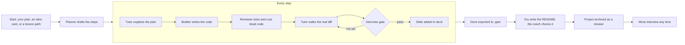

# VCPG

A local web app that vibe codes a project with you, and refuses to let you move on until you can explain every part of it.

AI coding tools make it easy to ship something you do not understand. That is fine until an interviewer asks why you chose cosine similarity, what happens at ten million users, or how you knew the model was any good. VCPG builds the project with a crew of Claude agents, but each step is taught before it is built, toured after it is reviewed, and locked behind an interview you have to pass. By the end you have working code, an interview slide deck, a README you wrote yourself, and the ability to walk anyone through the codebase.

> Status: in development. This README describes the intended system; the build plan is in [docs/BUILD_PLAN.md](docs/BUILD_PLAN.md).

## How a project runs



1. **Start.** Describe your own project, ask for ideas on a topic ("RAG and vectors") and pick one, or learn a concept from zero first with a generated lesson path.
2. **Plan.** The planner turns the mission into steps on a fixed spine (mission, architecture, data, core logic, interface, evaluation), adding or skipping modules the project needs.
3. **Teach, build, review, tour.** For each step the tutor explains the plan and the reasoning, the builder writes lean code, the reviewer runs tests and removes edge cases it cannot prove are reachable, and the tutor walks you through what actually changed.
4. **Gate.** An interviewer asks open questions while a separate grader scores your answers against a hidden rubric. Hints come first, a re-teach if you are stuck. The step stays locked until every rubric item is covered.
5. **Slide.** Each component gets one interview slide: what it does, the decisions and trade-offs, how it fails, and the questions you struggled with.
6. **Wrap up.** The deck is exported to PowerPoint. You write the README from a generated template, and a coach checks every claim against the real project. The project is compressed into a short dossier for later mock interviews.

## The crews

| Build crew | Job | Default model |
|---|---|---|
| Planner | Turns the idea into steps | Opus 5.5, high |
| Tutor | Teaches the plan, tours the diff | Sonnet 5.5, high |
| Builder | Writes the code | Opus 5.5, high (Agent SDK) |
| Reviewer | Tests and trims the code | Opus 5.5, high (Agent SDK) |
| Interviewer | Asks the gate questions | Sonnet 5.5, medium |
| Grader | Scores answers against the rubric | Opus 5.5, medium |
| Slide writer | Builds the interview deck | Haiku 5.5, medium |

The **audit crew** (Rook, Bolt, Echo and Pixel) audits the app itself: a quick scan after each project and a deep scan every two weeks. They read the logs of every agent call, propose fixes as GitHub pull requests with before-and-after test results, and auto-merge only a narrow set of low-risk changes. Every model and effort level can be changed on the Squad screen.

## Screens

Mission control (agent network, step loop, live console), start a project, concept lessons, squad loadout, audit bay, deck viewer, README coach, and the archive with mock interviews. Clickable prototypes live in [design/prototypes](design/prototypes); the visual spec is in [docs/DESIGN.md](docs/DESIGN.md).

## Tech

- **Backend:** Python 3.12, FastAPI, SQLite, Server-Sent Events for streaming
- **Agents:** Claude API for the conversational agents, Claude Agent SDK for agents that edit files, run commands and use git
- **Frontend:** React, TypeScript, Vite; Canvas 2D for the animated scenes; Motion for UI transitions
- **Sandbox:** Docker (or a per-project virtualenv) for running generated code and tests
- **Exports:** python-pptx for decks
- **Secrets:** OS keychain through `keyring`

## Getting started

Requires Python 3.12+, Node 20+, Git, and optionally Docker.

```bash
git clone https://github.com/<you>/vcpg.git
cd vcpg
make setup      # backend venv + frontend packages
make dev        # starts the API on 127.0.0.1:8000 and the UI on 127.0.0.1:5173
```

Open the app, click the core in mission control, and paste:

- an **Anthropic API key**
- a **fine-grained GitHub token** scoped to this repo, with *Contents* and *Pull requests* set to read and write and no other permissions

Both are stored in your OS keychain and never written to disk or logs. See [docs/SECURITY.md](docs/SECURITY.md).

## Documentation

- [docs/SPEC.md](docs/SPEC.md): what the app does, flow by flow
- [docs/ARCHITECTURE.md](docs/ARCHITECTURE.md): stack, state machine, data model
- [docs/AGENTS.md](docs/AGENTS.md): every agent's role, inputs, outputs and rules
- [docs/DESIGN.md](docs/DESIGN.md): theme, motion, screens, pixel characters
- [docs/SECURITY.md](docs/SECURITY.md): keys, sandboxing, auto-merge rules
- [docs/BUILD_PLAN.md](docs/BUILD_PLAN.md): phases and acceptance checks
