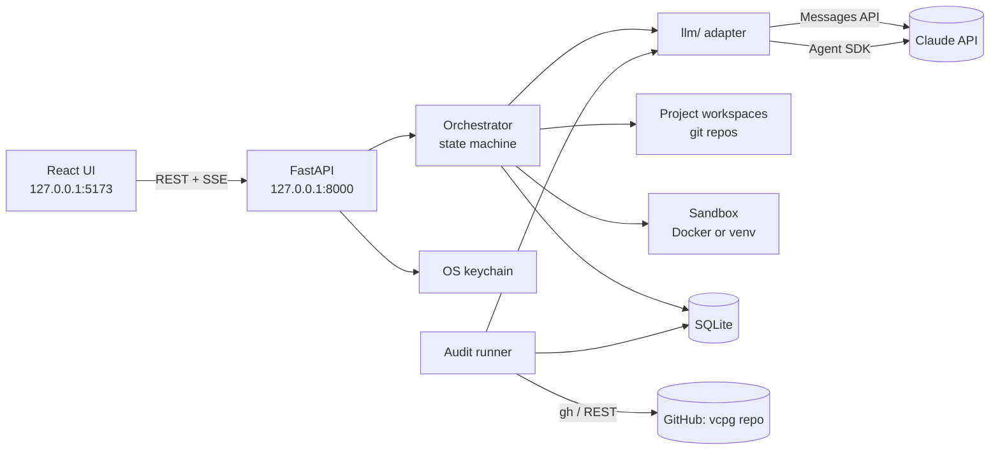
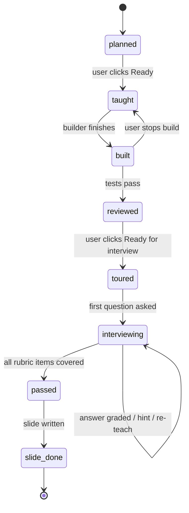

# Architecture

## 1. Overview



One process serves the API; long agent runs execute as asyncio tasks inside it and publish events to an in-memory bus that the SSE endpoint streams. Everything persistent is in SQLite or on disk under the data directory.

## 2. Repository layout

```
vcpg/
  backend/
    app.py               FastAPI app, routes mounted here
    routes/              projects, steps, gate, lessons, ideas, deck, readme, archive, squad, core, audit, events
    orchestrator/
      machine.py         step states and allowed transitions
      runner.py          drives a step through teach → build → review → tour → gate → slide
      build.py           background build per step: pause, resume, stop, retry
      planning.py        brief → questions → draft plan → edits → approve
      context.py         tagged data blocks for agent prompts
      project_end.py     final review, re-test, deck, README, dossier
      slides.py          slide writing, deck order, edits, regenerate, versioned exports
      wrapup.py          README template, coach review, finish; dossier with code checks
      mock.py            timed mock interviews from the dossier, live scorecard
      ideas.py           Give me ideas: cards, familiarity from history, Build this, Teach me first
    llm/
      client.py          Messages API calls: call(agent, messages, schema=None)
      sdk.py             Agent SDK sessions: run_agent(agent, task, cwd, ...)
      guard.py           PreToolUse rules for agent tool calls (SECURITY section 4)
      proxy.py           loopback proxy that adds the API key for Agent SDK sessions
      config.py          merges config/agents.yaml with Squad overrides
      prompts.py         loads prompts/<agent>.md
      log.py             records every call to agent_calls
    gate/
      rubric.py          gate state computed from grader output
    lessons/
      sources.py         ingest, split into passages, embed
      retrieve.py        top-k passages for a query
      validate.py        deterministic citation validator
      builder.py         lesson paths: outline, lessons on demand, section regeneration, answers
    workspace/
      git.py             init, commit, diff for project repos
      sandbox.py         run commands in Docker or a venv
    exports/
      pptx.py            python-pptx deck export
      pdf.py             PDF export
      render.py          diagrams and charts to PNG for exports
    audit/
      runner.py          quick and deep scans
      policy.py          auto-merge rules (see SECURITY.md)
      secrets_scan.py
      github.py          token checks; branches, commits, pull requests and merges via the API
      testsets.py        calibration sets scored per item, shared by `make live` and audits
    db.py                connection and numbered migrations (stdlib sqlite3)
    numbers.py           numbers a text states, for the slide and dossier checks
    schemas.py           Pydantic models for structured agent outputs (Plan, GateGrade, ...)
    errors.py            NotFound (404) and Conflict (409), mapped in app.py
    migrations/          NNN_name.sql files, applied in order; version kept in PRAGMA user_version
    secrets.py           keyring wrapper
    redact.py            log redaction filter (SECURITY.md section 2)
    paths.py             repo root and VCPG_HOME
    events.py            in-memory pub/sub for SSE
  frontend/
    src/
      screens/           MissionControl, Start, Lesson, Squad, AuditBay, Deck, Readme, Archive
      routes.tsx         one route per screen (screens.ts lists them)
      scenes/            canvas scenes: Background, CoreNetwork, auditRoom; pixel figures in sprites and suits
      components/        Panel, Console, Chip, CodeTour, GatePanel, SlideView, ...
      api/               typed client and SSE hook
      theme/tokens.css
  prompts/               one markdown file per agent
  templates/             slide layouts and README template guidance
  content/quizzes/       seeded lesson questions
  config/agents.yaml
  calibration/           gate and audit test sets (see AGENTS.md)
  design/prototypes/
  docs/
  tests/
  scripts/dev.py         starts API and UI together for `make dev`
  Makefile
```

Data lives outside the repo in `~/.vcpg/` (`vcpg.db`, `workspaces/<project_id>/`, `exports/<project_id>/`, `sources/`). The location is set by `VCPG_HOME`.

## 3. Step state machine



- Transitions are defined in one table in `machine.py`; anything else raises. Agents never set state.
- Review failures: `built → built` (builder retry once, with both notes), then the step is marked `blocked` with both notes until the user picks *Retry build* (`blocked → taught`) or *Edit plan* (the planner revises every unpassed step; on approval those steps are replaced).
- A project is `planning → active → finishing → done`. `finishing` covers final review, re-test, deck and README; `projects.finish_stage` holds which (`final_review → retest → deck → readme → done`).
- On restart, any step that was mid-run (`taught` with a running build, `built` with a running review) is resumed from its last committed state; partial agent runs are discarded.

## 4. Data model (SQLite)

| Table | Key columns |
|---|---|
| `projects` | id, name, brief, start_path (plan/idea/lesson), status, workspace_path, created_at, finished_at, plan_json (planner's latest draft, rubrics included, until approval), replan_json (a revision of the unpassed steps awaiting approval), finish_stage, final_review_json, retest_json |
| `steps` | id, project_id, position, title, component, goal, concepts (json), files (json), acceptance (json), state, build_note (json), review_note (json), commit_sha, tour_json |
| `rubric_items` | id, step_id, text, status (missing/partial/covered), evidence |
| `attempts` | id, step_id, kind (answer/hint/reteach), content, grader_json, created_at |
| `messages` | id, project_id, step_id, agent, role, content, created_at (tutor chat, tour Q&A, interviewer turns) |
| `slides` | id, project_id, step_id (null for title/overview/retro), kind, position, json, notes |
| `deck_exports` | id, project_id, version, format (pptx/pdf), path, created_at |
| `readmes` | id, project_id, template, content, review_json, ready |
| `lessons` | id, concept, path_json (outline, built lessons, dropped sections, cited passages), status, return_idea_id, return_card |
| `ideas` | id, topic, cards_json, created_at |
| `sources` | id, kind (trusted/community), title, url_or_path, added_by |
| `passages` | id, source_id, text, embedding (blob), position |
| `dossiers` | id, project_id, markdown |
| `mock_interviews` | id, project_id, length_min, focus, transcript, scorecard_json, started_at, ended_at |
| `agent_calls` | id, agent, model, effort, runtime, project_id, step_id, input_ref, output_ref, ok, error, duration_ms, created_at |
| `agent_overrides` | agent, model, effort |
| `audit_runs` | id, kind (project/deep), status, started_at, finished_at, report_json |
| `audit_issues` | id, run_id, agent, severity, title, evidence, status |
| `audit_prs` | id, run_id, issue_id, branch, pr_url, auto_merge (bool), state, before_json, after_json |

Full prompts and outputs for `agent_calls` are stored as files under `~/.vcpg/logs/` and referenced by path, so the database stays small. Logs never contain secrets (SECURITY.md).

## 5. LLM adapter

All Claude access goes through `backend/llm/`. No other module imports `anthropic` or `claude_agent_sdk`.

### 5.1 Config

`config.py` reads `config/agents.yaml`, applies rows from `agent_overrides`, and returns `AgentConfig(model, effort, runtime, max_tokens | max_turns)`. Effort below `medium` is rejected.

### 5.2 Messages API agents (`client.py`)

Used by planner, tutor, interviewer, grader, slide writer, lesson builder, idea generator, README coach, dossier writer.

```python
async def call(agent: str, messages: list[dict], schema: type[BaseModel] | None = None) -> str | BaseModel:
    cfg = load(agent)
    resp = await anthropic.messages.create(
        model=cfg.model,
        max_tokens=cfg.max_tokens,
        system=prompt(agent),
        messages=messages,
        output_config={"effort": cfg.effort},
    )
    ...  # log the call; if schema, parse JSON and validate, retry once with the error
```

Streaming variants (`stream(...)`) publish text deltas to the event bus for the tutor and interviewer. Check the current Anthropic Python SDK docs for exact parameter names at build time; keep the adapter the only place that needs changing if they differ.

### 5.3 Agent SDK agents (`sdk.py`)

Used by builder, reviewer and the audit crew: they edit files, run commands and use git.

```python
from claude_agent_sdk import query, ClaudeAgentOptions

async def run_agent(agent: str, task: str, cwd: Path, allowed: list[str], denied: list[str]):
    cfg = load(agent)
    options = ClaudeAgentOptions(
        model=cfg.model,
        effort=cfg.effort,
        system_prompt=prompt(agent),
        cwd=str(cwd),
        allowed_tools=allowed,
        disallowed_tools=denied,
        permission_mode="acceptEdits",
        max_turns=cfg.max_turns,
        setting_sources=[],          # ignore any CLAUDE.md or settings inside the workspace
        hooks={"PreToolUse": [guard]},
    )
    async for event in query(prompt=task, options=options):
        publish(event)               # to the console via SSE
        ...
```

- `cwd` is the project workspace (builder, reviewer) or a fresh clone of vcpg on an audit branch (audit crew).
- The `guard` hook checks every tool call against the rules in SECURITY.md section 4 and denies anything outside them, even if `allowed_tools` would allow it.
- Tool lists per agent are in AGENTS.md.
- **Keys never enter the session.** The Agent SDK runs the bundled Claude Code CLI as a child process, and that CLI needs a key. `proxy.py` starts a loopback server on a random port for each session; the CLI gets that URL as `ANTHROPIC_BASE_URL` and a random per-session secret as its `ANTHROPIC_API_KEY`. The proxy checks the secret, swaps in the real key from the keychain, and streams the reply. Every inherited environment variable whose name looks secret is blanked, and `CLAUDE_CONFIG_DIR` points at `~/.vcpg/agent-config` so the user's own Claude Code login and settings are never used.
- The guard allows the SDK's internal `StructuredOutput` tool, which is how a session returns its final JSON note.
- Pausing a build holds the next tool call in the guard hook until the user resumes.

## 6. Project workspace

- Each project is its own git repo at `~/.vcpg/workspaces/<project_id>/`, created at plan approval with a `.gitignore` and an empty README.
- The orchestrator commits after review passes (`step N: <title>`) and after the README is ready. Agents may run `git diff` and `git status` but never commit, reset or push; the orchestrator owns history.
- The code tour reads `git show <commit_sha>` for the step.
- Projects are never pushed anywhere by the app. The user can add a remote themselves.

## 7. Sandbox

`sandbox.py` runs commands for generated code and tests.

- **Docker (preferred):** one container per project from a slim language image, workspace mounted read-write, network off by default, CPU and memory limits, a timeout per command. Network can be turned on per command for package installs only (`pip install`, `npm install`) during the build step.
- **venv fallback:** used when Docker is missing; the build panel warns that isolation is weaker. Commands run in a per-project virtualenv at `~/.vcpg/venvs/<project_id>/` with the workspace as `cwd`, a stripped environment (no keys), and a timeout. Package caches go to `~/.vcpg/tmp/<project_id>/`, not the workspace. On Windows, `USERPROFILE`, `TEMP` and `TMP` also point into VCPG's folders, and `SYSTEMROOT` is kept, because without it Windows cannot load its socket provider and even `import asyncio` fails. The venv mode therefore has no network isolation at all; only Docker cuts the network.
- The builder and reviewer run commands through the sandbox via a custom tool (`run_in_sandbox`) rather than raw Bash where possible.

## 8. Streaming

- `GET /api/events?project_id=...` is an SSE stream of events: `agent_started`, `agent_text` (deltas), `tool_use` (summarised: file path or command), `tool_result` (short), `state_changed`, `gate_update` (counts only), `audit_update`.
- The frontend keeps one EventSource per open project and reconnects with `Last-Event-ID`; the server keeps the last 500 events per project in memory for replay.

## 9. Lessons retrieval

- Sources are split into passages of about 200 to 400 words at heading or paragraph boundaries, with stable IDs (`<source_id>:<position>`).
- Embeddings use a small local model (`sentence-transformers/all-MiniLM-L6-v2`), run through `fastembed` (ONNX) rather than the `sentence-transformers` package so no PyTorch install is needed; the model downloads once into `~/.vcpg/models/`. Vectors live in the `passages` table; search is brute-force cosine over stored passages (small enough that an index is not needed).
- Seeded open sources live in `content/sources.yaml` (official documentation only, so they count as trusted). When a lesson finds no trusted passage scoring at least 0.3 for its topic, the seeds whose topics match the concept's words are fetched and stored.
- URL sources are fetched over http(s) only, never to loopback, private or link-local addresses, without following redirects, and limited to 50 MB. Uploads (PDF, markdown, text) arrive as the raw request body and are parsed, never executed.
- Lesson paths are written in two steps: an outline of 4 to 8 lessons, then each lesson when it is opened. Each section is validated; a rejected section is regenerated with the validator's errors up to twice, then dropped with a note. Code answers run their pytest tests in the sandbox under a reserved id (0) that no project uses.
- The lesson builder receives only retrieved trusted passages (with IDs) and, separately labelled, community snippets. `validate.py` enforces the grounding rule in SPEC section 9.2.

## 10. Exports

- `render.py` draws every visual kind (architecture, flow, chart, code, table) with matplotlib in the Solar palette, so exports need no browser or mermaid CLI. Code visuals use the file from the step's commit.
- `pptx.py` builds 16:9 slides from slide JSON with fixed layouts per visual kind, Solar colours, fonts embedded as names with fallbacks (Oxanium → Arial, IBM Plex Sans → Calibri), and speaker notes.
- `pdf.py` renders each slide as a full page with the same matplotlib drawing code, one page per slide in deck order, so no LibreOffice is needed.
- Exports are written to `~/.vcpg/exports/<project_id>/deck_v<n>.<format>`; each format counts its own versions.

## 11. Audit runner

- Scheduler: on startup and every hour, check whether a deep scan is due: 14 days since the last one, an Anthropic key saved, and agent calls logged since. Project scans start when a project is archived (`wrapup.finish`). The audit bay can start a deep scan by hand. One run at a time.
- Each run clones vcpg into `~/.vcpg/audit/<run_id>/clone`. Bolt, Echo and Pixel run in parallel as **read-only** Agent SDK sessions (Read, Glob and Grep over the clone and `~/.vcpg/logs/`; the guard denies every edit, shell and sandbox call), each on its slice of `agent_calls`, and return an `AuditReport`. Rook reads the three reports and the clone, also read-only, and returns a `RookPlan`: each fix carries the **complete new content** of every file it changes, so no agent ever edits the repository.
- For each fix, code (not an agent) decides: a fix touching a path Rook may never change is dropped; the diff is computed against GitHub's current `main` (`github.file_at`); any secret-scan hit blocks it and raises a high-severity issue; the unit suite runs on a fresh clone with the change **inside the sandbox** (reserved id -1; tests marked `network` are skipped there); the relevant calibration sets (`testsets.relevant`) are scored before and after in-process, with the proposed prompt and template files laid over a copy of the data folders (`prompts.root`); then `policy.py` checks every auto-merge rule.
- **No git push.** The branch `audit/<run_id>/<slug>`, its commit, the pull request and any merge are made through the GitHub REST API from VCPG's own process (`audit/github.py`), with the token from the keychain in an HTTP header only. Merges use the pull request merge endpoint with `merge_method: merge`.
- The token is checked on save by probing: it must read the vcpg repo; a 200 from an admin-only, secrets, webhooks or account endpoint, or access to any other repository, refuses it. GitHub offers no way to list a fine-grained token's permissions, so Workflows and Actions write cannot be detected; Core access says so.

## 12. API surface (summary)

| Route | Purpose |
|---|---|
| `POST /api/projects` | create from plan, idea or lesson |
| `GET /api/projects/current` · `GET /api/projects/{id}` | project with public plan draft and steps |
| `POST /api/projects/{id}/plan/answers` · `/plan/revise` · `PUT /api/projects/{id}/plan` | answer planner questions, ask for changes, reorder/rename/drop steps |
| `POST /api/projects/{id}/plan/approve` | lock plan, init workspace |
| `POST /api/steps/{id}/advance` | user actions: ready, build, retry (from blocked), stop, pause, resume, ready_for_interview |
| `POST /api/steps/{id}/gate/answer` · `/hint` · `/reteach` | gate actions |
| `POST /api/steps/{id}/ask` | tutor side chat |
| `GET /api/steps/{id}` · `POST /api/steps/{id}/teach` | step view (progress as counts only) and the tutor's lesson |
| `POST /api/steps/{id}/tour` · `GET /api/steps/{id}/file?path=` | code tour, and a toured file as it is in the step's commit |
| `POST /api/projects/{id}/replan` · `/replan/approve` · `DELETE /replan` | Edit plan: propose, approve or discard a revision of the unpassed steps |
| `GET /api/projects/{id}/deck` · `POST /deck/order` · `/deck/export` | deck, reorder, export (pptx or pdf) |
| `PUT /api/slides/{id}` · `POST /api/slides/{id}/regenerate` · `GET /api/exports/{id}/download` | inline edit, regenerate one slide, download a version |
| `POST /api/projects/{id}/final-review` · `/retest/start` · `/retest/answer` · `/deck/prepare` · `/deck/done` | end-of-project stages |
| `GET/PUT /api/projects/{id}/readme` · `POST /readme/template` · `/readme/review` · `/readme/finish` | README editor and coach; finish commits it, writes the dossier, archives the project |
| `POST /api/ideas` · `GET /api/ideas/{id}` · `POST /api/ideas/{id}/build` · `/teach` | Give me ideas, Build this, Teach me first |
| `POST /api/lessons` · `GET /api/lessons[/{id}]` · `POST /api/lessons/{id}/build/{n}` · `/answer` | lesson paths, a lesson on demand, question answers |
| `GET /api/sources` · `POST /api/sources/url` · `POST /api/sources/upload?filename=&kind=` | lesson sources |
| `GET /api/archive` · `POST /api/archive/{id}/mock` · `GET /api/mock/{id}` · `POST /api/mock/{id}/answer` · `/end` | archive and mock interviews |
| `GET/PUT /api/squad` | agent overrides |
| `GET/PUT/DELETE /api/core/{anthropic,github}` | key status, save, test, remove (keys are never returned) |
| `GET /api/audit` · `POST /api/audit/run` | audit state and manual deep scan |
| `GET/PUT/DELETE /api/core/github` · `POST /api/core/github/test` | GitHub token: status, checked save, test, remove |
| `GET /api/events` | SSE |
| `GET /api/health` | liveness check |
| `GET /api/session` | per-launch token; every non-GET request must send it as `X-VCPG-Token` |
